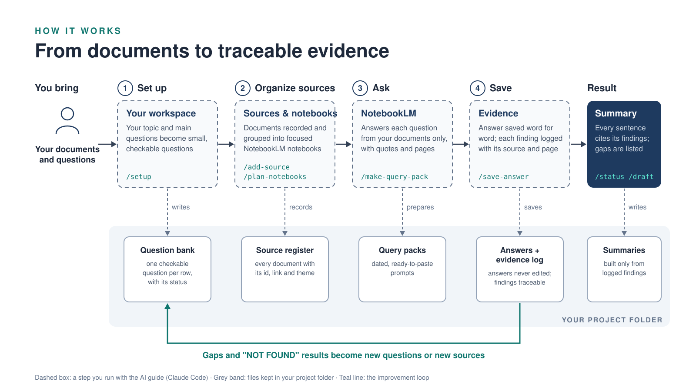

# Knowledge Package Starter Kit

A ready-made research workspace. You bring the documents; an AI guide sets everything up with you, and NotebookLM answers your questions using only your documents. Every finding is saved with its quote, source and page. No coding needed.

## How to start

1. Click the green **Code** button above, then **Download ZIP**, and unzip it.
2. Open the folder in **Claude Code** ([download](https://claude.ai/download)).
3. Type **`/setup`** and answer the questions.

New here? Read **[START_HERE.md](START_HERE.md)** first.

## What's inside

| Folder | What it is |
|---|---|
| [START_HERE.md](START_HERE.md) | Your first read |
| [guide/](guide/) | Step-by-step instructions, in plain language |
| [prompts/notebooklm/](prompts/notebooklm/) | Ready-made prompts to paste into NotebookLM |
| [example-mexico-displacement/](example-mexico-displacement/) | A finished example: forced displacement in Mexico |
| `projects/` | Your own projects (stay on your computer) |
